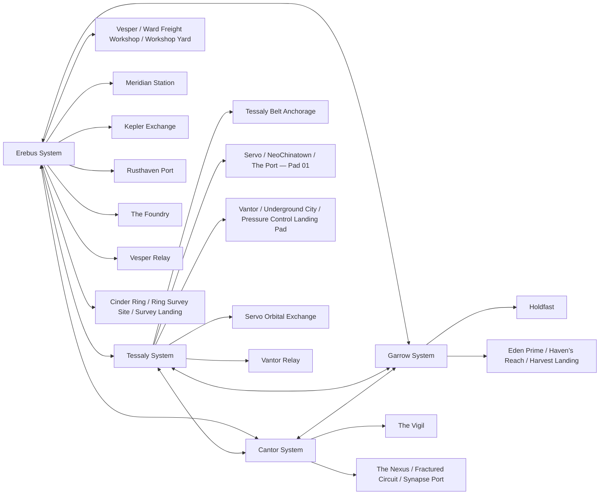

# Universe asset development manifest

Generated from the flight registry and walking layouts with `node tools/universe-manifest.cjs`.

## Universe map

Each system marker leads to open space. Local warp routes connect the destinations listed for that system. Access follows campaign discovery. Rook grants Erebus and Tessaly coordinates. Faction missions unlock Cantor and Garrow independently, and each homeworld requires its own unlock.

Local lines in this diagram show departures from arrival space. Any two unlocked local pads or stations also connect directly. You can jump to a different known system from any of its neighbours’ flight locations. Only discovered systems appear as interstellar routes. The diagram shows connections available after all four systems have been discovered.

### Erebus System

Ownership — Independent. Central warp marker — `erebus-arrival`.

| Destination | Permanent flight ID | Type | Planet / settlement |
| --- | --- | --- | --- |
| Vesper | `vesper` | pad | Vesper / Ward Freight Workshop / Workshop Yard (provisional) |
| Meridian Station | `meridian` | station | Cinder Ring (provisional) |
| Kepler Exchange | `kepler` | station | Independent space facility |
| Rusthaven Port | `rusthaven` | station | Independent space facility |
| The Foundry | `foundry` | station | Independent space facility |
| Vesper Relay | `vesper-relay` | station | Vesper |
| Survey Landing | `cinder-landing` | pad | Cinder Ring (provisional) / Ring Survey Site (provisional) / Survey Landing (provisional) |

### Tessaly System

Ownership — Independent. Central warp marker — `sol-arrival`.

| Destination | Permanent flight ID | Type | Planet / settlement |
| --- | --- | --- | --- |
| Tessaly Belt Anchorage | `sol-belt` | anchorage | Independent space facility |
| NeoChinatown | `earth` | pad | Servo / NeoChinatown / The Port — Pad 01 |
| Vantor / Underground City | `mars` | pad | Vantor / Underground City / Pressure Control Landing Pad (provisional) |
| Servo Orbital Exchange | `servo-orbital` | station | Servo |
| Vantor Relay | `vantor-relay` | station | Vantor |

### Cantor System

Ownership — communion. Central warp marker — `communion-arrival`.

| Destination | Permanent flight ID | Type | Planet / settlement |
| --- | --- | --- | --- |
| The Vigil | `vigil` | station | The Nexus |
| The Nexus | `nexus` | pad | The Nexus / Fractured Circuit (provisional) / Synapse Port (provisional) |

### Garrow System

Ownership — natural-order. Central warp marker — `natural-order-arrival`.

| Destination | Permanent flight ID | Type | Planet / settlement |
| --- | --- | --- | --- |
| Holdfast | `holdfast` | station | Eden Prime (provisional) |
| Natural Order Homeworld | `order-homeworld` | pad | Eden Prime (provisional) / Haven’s Reach (provisional) / Harvest Landing (provisional) |

## Modular Blender specifications

Use metres and apply object transforms before exporting glTF. Babylon uses Y up. Export a 1 m reference cube and a forward-axis marker when validating a replacement. Retain the layout origin, interaction IDs, collision volumes and boarding position. Name render meshes separately from simple collision proxies. Use baked materials, a small number of shared lights and the existing scene loader.

### Vesper Relay (provisional)

- ID and parent — `vesper-relay`, Erebus System, Vesper.
- Theme — independent industrial orbital transfer facility.
- Existing assets — modular hangar walls, ceiling, deck and parked ship.
- Spawn — [0,1.7,-17] m, yaw 0 rad. Boarding interaction — [-2,1.7,-14] m.
- Ground elevation — 0 m. Ship anchor — [-7, 2, -9] m. Hangar deck 36 × 30 m.
- Walking bounds — x ±18 m and z ±26 m; retain wall collision.
- Reserved expansion — extend behind the rear bulkhead at z = 4 m. Place a future crew or mission contact beyond the new pressure door after the adjoining room exists.
- Needed from art — station hull art, local signage, hangar material set and future interior modules. NPCs and missions are reserved for later production.

### Servo Orbital Exchange (provisional)

- ID and parent — `servo-orbital`, Tessaly System, Servo.
- Theme — independent industrial orbital transfer facility.
- Existing assets — modular hangar walls, ceiling, deck and parked ship.
- Spawn — [0,1.7,-17] m, yaw 0 rad. Boarding interaction — [-2,1.7,-14] m.
- Ground elevation — 0 m. Ship anchor — [-7, 2, -9] m. Hangar deck 36 × 30 m.
- Walking bounds — x ±18 m and z ±26 m; retain wall collision.
- Reserved expansion — extend behind the rear bulkhead at z = 4 m. Place a future crew or mission contact beyond the new pressure door after the adjoining room exists.
- Needed from art — station hull art, local signage, hangar material set and future interior modules. NPCs and missions are reserved for later production.

### Vantor Relay (provisional)

- ID and parent — `vantor-relay`, Tessaly System, Vantor.
- Theme — independent industrial orbital transfer facility.
- Existing assets — modular hangar walls, ceiling, deck and parked ship.
- Spawn — [0,1.7,-17] m, yaw 0 rad. Boarding interaction — [-2,1.7,-14] m.
- Ground elevation — 0 m. Ship anchor — [-7, 2, -9] m. Hangar deck 36 × 30 m.
- Walking bounds — x ±18 m and z ±26 m; retain wall collision.
- Reserved expansion — extend behind the rear bulkhead at z = 4 m. Place a future crew or mission contact beyond the new pressure door after the adjoining room exists.
- Needed from art — station hull art, local signage, hangar material set and future interior modules. NPCs and missions are reserved for later production.

### Survey Landing (provisional)

- ID and parent — `cinder-landing`, Erebus System, Cinder Ring.
- Theme — independent ring survey outpost on an undeveloped world.
- Existing assets — survey ground, landing pad and parked ship.
- Spawn — [0,1.7,-20] m, yaw 0 rad. Boarding interaction — [-2,1.7,-25] m.
- Ground elevation — 0 m. Ship anchor — [-4, 1.1, -29] m, yaw 0.3 rad. Circular pad diameter 24 m.
- Walking bounds — x ±120 m and z ±120 m; retain wall collision.
- Reserved expansion — build north of z = 8 m, inside the 240 m square walking area. Keep the pad and boarding corridor clear. A future entry or mission contact may attach at [0, 0, 16] m.
- Needed from art — site-specific surface materials, future buildings and low-intensity pad lighting. NPCs and missions are reserved for later production.
