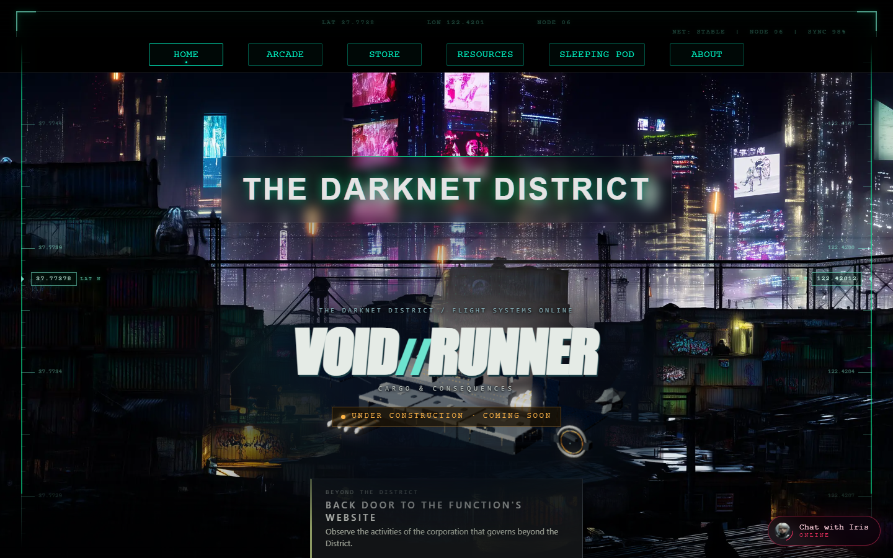
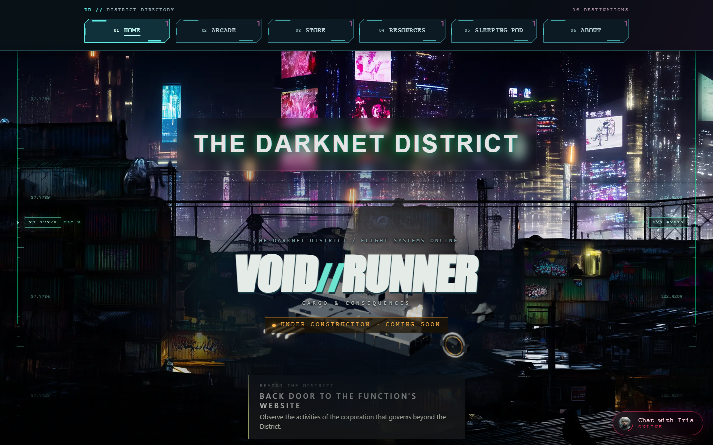
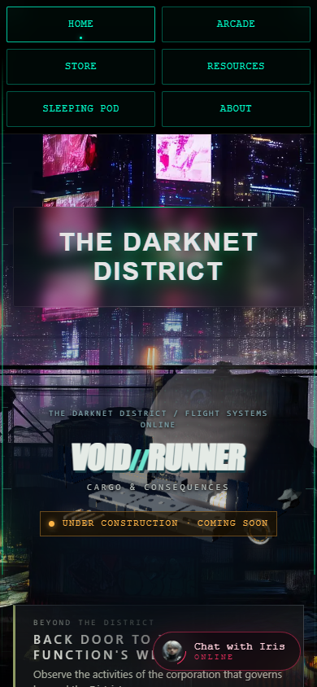
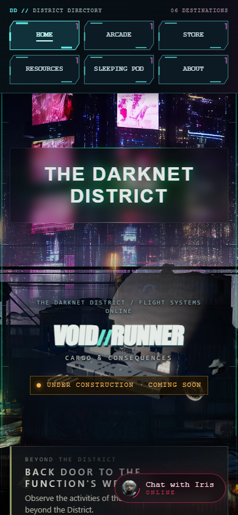
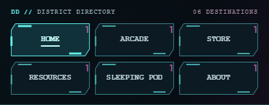

# Homepage navigation prototype — awaiting design approval

Prepared 2026-10-28 from `main` at `68b34532cf60dfdc48d377e6f4c264dafe653f5b`.
Branch: `codex/home-navigation-prototype`.

Only the root homepage uses the new design. No site-wide rollout, merge or deployment is authorized by this prototype. Approval is required before extending it.

## Design

Original inline SVG frames have chamfered corners, thin cyan outlines, segmented rails and a restrained magenta corner accent. Dark opaque panels keep contrast predictable over the existing animated homepage. Home has a stronger border, filled panel and underline, so the active state is not conveyed by color alone. The warm-white keyboard outline sits outside the frame and stays visible.

Six native links remain in their original order and preserve their exact destinations. Desktop uses one row; mobile uses three columns and two rows, with two columns below 360px. Links have at least 48px height. The navigation stays in document flow and sticks to the top. No new JavaScript, fonts, image assets or dependencies are required. SVG decorations are hidden from assistive technology and keyboard focus. Reduced motion removes transitions; forced-colors mode uses system-color borders.

Reference artwork was used for visual inspiration only. None of the supplied reference files were copied into the site.

## Screenshots

Captured locally in Edge at 1440×900 and 390×844 with reduced motion. Existing animated hero imagery can differ between captures. All screenshots were visually inspected.

Desktop before:

Desktop prototype:

Mobile before and prototype:

 

Navigation details:

[Keyboard focus screenshot](keyboard-focus.png)

## Route audit and pending rollout

| Section | Existing route | Finding before prototype |
| --- | --- | --- |
| Home | `/` | All six destinations; separate inline navigation and accent styles |
| Arcade | `games-list.html` | Home, Arcade (labelled Play a Game), Store only |
| Store | `store-first-page.html` | Home, Arcade, Store, About; missing Resources and Sleeping Pod |
| Resources | `resources.html` | All six destinations |
| Sleeping Pod | `sleeping_pod.html` | Three existing return links; preserve quiet layout and use minimal return access during approved rollout |
| About | `about.html` | Home, Arcade (labelled Play a Game), Store only |

Store category pages (`store-apparel`, `store-apps`, `store-books`, `store-electronics`, `store-neurohackers`, `store-survival`) also omit Resources and Sleeping Pod. Resource pages `biohacking`, `borderless`, `curious`, `leaks`, `legal_resources`, `neurodivergent` and `opsec` omit Sleeping Pod. The book page has four links. `404.html` already has all six.

Other specialty pages (`anti-osint`, `osint`, `obs`, `raven`, Iris pages, chatbot and game pages) do not use the common top-navigation markup; their existing return controls and embedding context need review during rollout. This is an inventory of common navigation markup, not a claim that those pages lack all links.

VOID//RUNNER has its own game interface and does not load this stylesheet. No game file was changed. Sleeping Pod also does not load the prototype. All destination pages retain their existing design at this approval checkpoint.

After approval, centralize navigation configuration/rendering with a progressive enhancement strategy suited to the static GitHub Pages architecture. Include active states, preserve native link access without JavaScript, cover main sections and relevant subpages, keep Sleeping Pod minimal, and keep full navigation out of active gameplay. That implementation is intentionally pending approval.

## Files changed

- `index.html`: semantic homepage navigation, original inline SVG frames, static active-page state, scoped stylesheet link.
- `home-navigation.css`: homepage opt-in presentation and responsive/accessibility states. The prototype avoids the legacy `.top-nav` class to prevent old glitch and responsive rules from conflicting.
- `tests/home-navigation-browser.cjs`: browser regression checks and screenshot capture.
- `tests/function-archive.test.cjs`: update the existing navigation assertion to allow nested label/decorative markup while still checking routes and labels; add Sleeping Pod coverage.
- `docs/navigation-prototype/`: review report and before/after/focus screenshots.

## Validation

- **400/400 Node unit tests passed.**
- Homepage browser suite passed in Edge: six route responses, exactly one active page, 11 widths (320, 360, 390, 540, 680, 768, 900, 1024, 1280, 1440, 1920), label fit, hit areas, overlap and horizontal overflow checks.
- Tab order and visible focus across all six links; Enter navigates to About. SVGs do not become tab stops.
- Touch tap opens Arcade. Navigation and active Home state work with JavaScript disabled.
- Normal-motion hover, sticky positioning and the existing Iris chat toggle work.
- Reduced-motion and Windows forced-colors checks passed. Specified text colors exceed 4.5:1 contrast against panel colors; default frame contrast exceeds 3:1.
- Sleeping Pod and VOID//RUNNER do not load the prototype.

Run `node --test tests/*.test.cjs`. For screenshots/browser checks, serve the repository root on port 5194, install existing dev dependencies if needed, and run `node tests/home-navigation-browser.cjs`. Optional environment variables: `SITE_TEST_URL`, `BROWSER_CHANNEL` (defaults to msedge) and `NAV_SCREENSHOTS` (defaults to ignored `work/navigation-review`).

## Limits

This is a homepage design review, not a completed cross-site navigation migration. Active states on other pages and the shared component await approval. External services were blocked during browser tests: authentication, checkout, analytics and backend chat replies were not exercised. No physical handheld or screen-reader session was run; mobile uses browser touch emulation, alongside semantic/accessibility checks. Existing hero, HUD and chat layout issues are outside this navigation-only change. The backend static homepage mirror is not part of the GitHub Pages homepage prototype.
